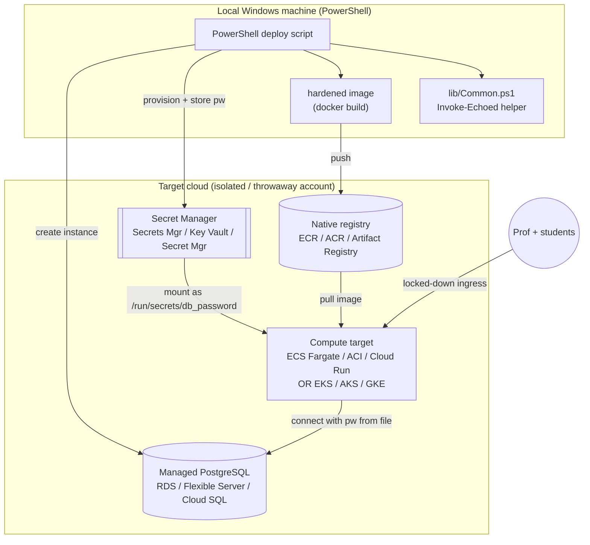
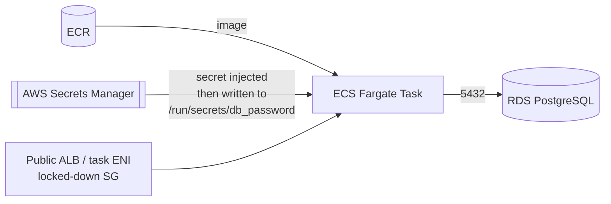
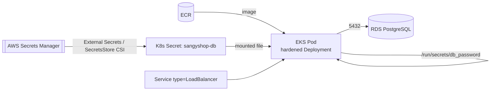
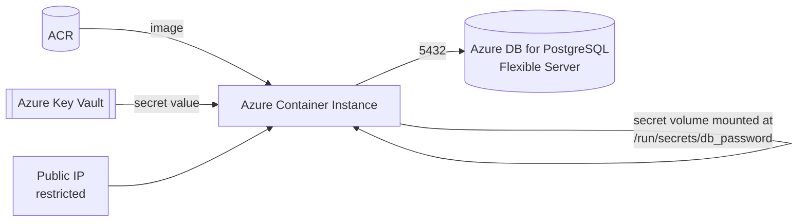
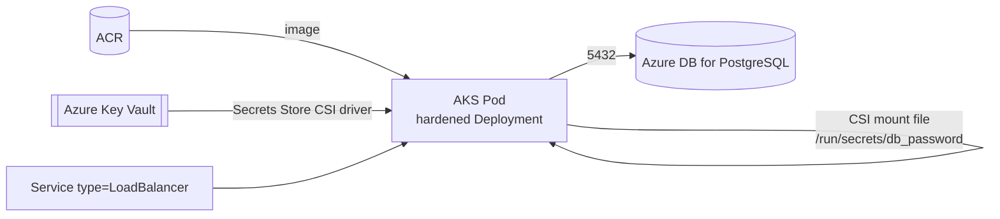
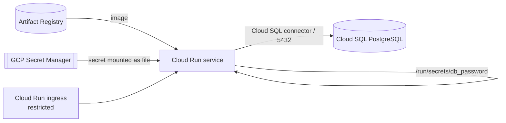
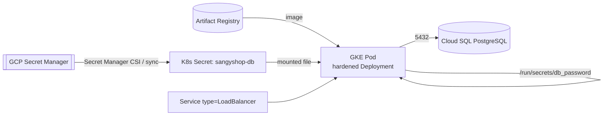

# Design Document: multi-cloud-deploy

> ⚠️ **TEACHING-LAB SECURITY WARNING — READ FIRST**
>
> SangyShop is **deliberately vulnerable by design**. The "hardened" variant improves the
> *deployment posture* (non-root, read-only FS, dropped capabilities, secret files, least-privilege
> RBAC/NetworkPolicies) but the **application code is still intentionally exploitable** (SQLi, auth
> bypass, etc.). Deploying it to a public cloud means putting a known-vulnerable app on the internet.
>
> Therefore, everything in this feature MUST be used **only**:
> - in an **isolated / throwaway cloud account or project** (never a shared or production account),
> - behind **locked-down ingress** (restrict to your own IP / a private network; never `0.0.0.0/0` for the app),
> - and **torn down immediately after the lesson** (every deploy has a matching destroy script).
>
> Never leave a cloud deployment of SangyShop running or exposed. Always run teardown. These cloud
> resources are **billable** — forgetting teardown costs real money.

## Overview

This feature adds a dedicated folder of **PowerShell deployment scripts** that take the existing
**hardened** SangyShop variant and deploy it to **three public clouds** (AWS, Azure, GCP), each in
**two modalities**: a simple "Docker-only" managed container service and an orchestrated "Kubernetes"
managed cluster. Each target uses the cloud's **managed PostgreSQL** service and the cloud's **native
image registry**, and injects the managed DB password into the app as the file
`/run/secrets/db_password` — exactly the path and fail-closed contract that
`src/db/credentials.js` already consumes in hardened mode.

The design is **script-first and CLI-driven**: every script uses the cloud's own CLI (`aws`, `az`,
`gcloud`) plus `kubectl`, and **every CLI command is echoed to stdout before it runs** through a
single shared PowerShell helper. The app is never modified — the three clouds differ only in how
they provision infrastructure and how they deliver the secret file to the container. Only the
**hardened** variant is deployed to the cloud; the insecure variant stays local-only.

The scope is six deploy targets (3 clouds × 2 modalities), each with a build+push step, a managed
Postgres + secret step, a deploy step, a URL-output step, and a matching teardown step, all
parameterized per user and never embedding secrets.

---

# Part 1 — High-Level Design (Architecture, Diagrams, Interfaces)

## Architecture

The architecture is identical in shape across all six targets; only the concrete cloud services
change. Five building blocks participate in every deployment:

1. **Build + Registry** — the hardened image is built locally from
   `deployment-security/docker/hardened/Dockerfile` and pushed to the cloud's native registry
   (ECR / ACR / Artifact Registry).
2. **Managed PostgreSQL** — a managed DB instance (RDS / Azure DB for PostgreSQL Flexible Server /
   Cloud SQL) replaces the self-hosted Postgres pod/container. It is **never** a container in the cloud.
3. **Secret Manager** — the generated DB password is stored in the cloud's secret manager (AWS Secrets
   Manager / Azure Key Vault / GCP Secret Manager) and is the single source of truth.
4. **Secret → file injection** — the key integration point. Each target maps the stored secret to the
   file `/run/secrets/db_password` inside the running container so the unmodified hardened app reads it.
5. **Compute** — either the Docker-only managed container service (ECS Fargate / ACI / Cloud Run) or
   the managed Kubernetes service (EKS / AKS / GKE) running the existing hardened manifests.



### Per-cloud, per-modality topology

The following diagrams show how the five blocks wire together for each target. The **critical,
repeated detail** is the arrow from the secret manager to the container as the file
`/run/secrets/db_password`.

#### AWS — Docker-only (ECS Fargate)



> Fargate injects secrets as **environment variables** from Secrets Manager. Because the hardened app
> refuses to read the password from the env, the task definition uses a tiny **entrypoint wrapper**
> step (or a sidecar/`command` prefix) that writes the injected secret value to
> `/run/secrets/db_password` before launching `node src/server.js`. See Low-Level §"AWS secret→file".

#### AWS — Kubernetes (EKS)



#### Azure — Docker-only (ACI)



> **Why ACI over Container Apps:** ACI is the closest Azure analog to "just run my container" — a single
> container group with no ingress controller, revision model, or Dapr layer to reason about. It supports
> a **secret volume** that mounts files directly, which maps cleanly to `/run/secrets/db_password`
> without an entrypoint wrapper. Container Apps is better for autoscaling HTTP apps but adds concepts a
> teaching lab does not need here.

#### Azure — Kubernetes (AKS)



#### GCP — Docker-only (Cloud Run)



> Cloud Run natively supports **mounting a Secret Manager secret as a file at an arbitrary path** —
> set the mount path to `/run/secrets/db_password` and no wrapper is needed.

#### GCP — Kubernetes (GKE)



## Proposed Folder Structure

Everything lives under a new `deployment-security/cloud/` tree, mirroring the existing
`docker/` + `kubernetes/` split but organized **cloud-first** so a user working with one cloud sees
only that cloud's scripts.

```
deployment-security/
  cloud/
    README.md                     # per-cloud CLI install + auth, prerequisites, cost, teardown
    cloud.config.example.ps1      # copyable parameter template (region, names, ids) — safe defaults
    lib/
      Common.ps1                  # shared helpers: Invoke-Echoed, logging, config load, password gen
    aws/
      docker/
        deploy.ps1                # ECR build+push -> RDS -> Secrets Mgr -> ECS Fargate -> URL
        teardown.ps1
      kubernetes/
        deploy.ps1                # ECR -> RDS -> Secrets Mgr -> EKS (hardened manifests) -> URL
        teardown.ps1
    azure/
      docker/
        deploy.ps1                # ACR -> Flexible Server -> Key Vault -> ACI -> URL
        teardown.ps1
      kubernetes/
        deploy.ps1                # ACR -> Flexible Server -> Key Vault -> AKS -> URL
        teardown.ps1
    gcp/
      docker/
        deploy.ps1                # Artifact Registry -> Cloud SQL -> Secret Mgr -> Cloud Run -> URL
        teardown.ps1
      kubernetes/
        deploy.ps1                # Artifact Registry -> Cloud SQL -> Secret Mgr -> GKE -> URL
        teardown.ps1
    manifests/
      overlays/                   # per-cloud k8s adaptations (StorageClass, LB Service, image ref,
        aws/                      #   secret wiring) layered on the existing hardened manifest
        azure/
        gcp/
```

**Why this structure:**
- **Cloud-first top level** (`aws/ azure/ gcp/`) matches how a user thinks ("I'm doing the AWS lab
  today") and how credentials/CLIs are scoped — one cloud's auth never bleeds into another's folder.
- **`docker/` vs `kubernetes/` under each cloud** mirrors the existing
  `deployment-security/docker|kubernetes` convention, so the mental model is already familiar.
- **`lib/Common.ps1`** centralizes the echoed-command helper and config loading so the echo
  requirement is implemented **once** and reused everywhere (impossible to "forget" per script).
- **`manifests/overlays/<cloud>`** keeps the existing hardened manifest as the source of truth and
  isolates only the per-cloud deltas, avoiding six copies that drift.
- **Open to future Bash parity:** a sibling `*.sh` can later sit next to each `*.ps1` (and a
  `lib/common.sh` next to `Common.ps1`) without moving anything. The structure does not assume PowerShell.
- **`cloud.config.example.ps1`** is committed; the real `cloud.config.ps1` is git-ignored, so per-user
  values and any generated names never land in version control.

## Common Deploy Flow

Every `deploy.ps1`, regardless of cloud or modality, follows the same ordered pipeline. Each step is a
function in `lib/Common.ps1` or the script, and **each cloud CLI call inside a step is echoed first**.

```mermaid
flowchart TD
    A[Load + validate config] --> B[Ensure CLI auth<br/>aws/az/gcloud + kubectl]
    B --> C[Ensure registry exists]
    C --> D[docker build hardened image]
    D --> E[Tag + push to native registry]
    E --> F[Provision managed PostgreSQL<br/>idempotent: create or reuse]
    F --> G[Generate DB password<br/>if not already stored]
    G --> H[Store password in secret manager]
    H --> I[Deploy compute target<br/>wiring secret -> /run/secrets/db_password]
    I --> J[Wait for ready + fetch public URL]
    J --> K[Print URL + ingress-lockdown reminder]
    K --> L[(later) teardown.ps1 destroys everything]
```

Teardown reverses the flow: delete compute → delete DB (optionally skip data deletion prompt) →
delete secret → optionally delete registry/image → report what was removed.

## How the Echoed-Command Requirement Fits

This is a **first-class, cross-cutting design element**, not a logging afterthought. Every external
command (every `aws`, `az`, `gcloud`, `kubectl`, and `docker` invocation) is executed **exclusively**
through the shared `Invoke-Echoed` helper in `lib/Common.ps1`. The helper prints the exact command
line (executable + all arguments) to stdout immediately before executing it, so a student following
along in the terminal sees precisely what the script does against their cloud account — and can copy
any single command to run it manually. No script is permitted to call a cloud CLI directly. This is
captured as a correctness property below and enforced by review/test.

## Cross-Cloud Comparison

| Concern | AWS | Azure | GCP |
|---|---|---|---|
| CLI | `aws` (+ `eksctl` optional) | `az` | `gcloud` |
| Native registry | ECR | ACR | Artifact Registry |
| Docker-only compute | ECS Fargate | Azure Container Instances (ACI) | Cloud Run |
| Managed Kubernetes | EKS | AKS | GKE |
| Managed PostgreSQL | RDS for PostgreSQL | Azure DB for PostgreSQL (Flexible Server) | Cloud SQL for PostgreSQL |
| Secret manager | AWS Secrets Manager | Azure Key Vault | GCP Secret Manager |
| Secret→file (Docker-only) | entrypoint wrapper writes env secret to file | ACI **secret volume** mounts file directly | Cloud Run **secret file mount** directly |
| Secret→file (k8s) | SecretsStore CSI / External Secrets → mounted file | Key Vault **Secrets Store CSI** → mounted file | Secret Manager CSI / sync → mounted file |
| Public URL source | ALB DNS / task public IP | ACI FQDN / public IP | Cloud Run service URL |
| k8s LoadBalancer | AWS ELB | Azure LB | GCP LB |
| DB connectivity note | SG allow app → 5432 | FW rule / VNet to Flexible Server | Cloud SQL connector or authorized network |

Key asymmetry to note in the design: **Cloud Run and ACI mount secrets as files natively**, so the
Docker-only modality needs no app change there; **ECS Fargate injects secrets as env vars**, so its
Docker-only modality needs the entrypoint wrapper to honor the fail-closed `/run/secrets/db_password`
contract. All three Kubernetes modalities deliver the secret as a mounted file via a CSI driver,
matching the existing hardened manifest's `db-secret` volume at `/run/secrets`.

## Components and Interfaces

### Component 1: `lib/Common.ps1` (shared library)

**Purpose:** single home for the echoed-command helper, structured logging, config loading/validation,
and DB-password generation. Dot-sourced by every `deploy.ps1`/`teardown.ps1`.

**Interface (PowerShell function contracts):**
```powershell
# Prints the exact command, then runs it; throws on non-zero exit.
function Invoke-Echoed { param([string]$Exe, [string[]]$CmdArgs, [switch]$AllowFail) }

# Section/step banners and status lines (consistent, greppable output).
function Write-Step    { param([string]$Message) }

# Loads cloud.config.ps1 (or -ConfigPath), applies defaults, validates required keys.
function Get-CloudConfig { param([string]$ConfigPath) }  # -> [hashtable]

# Generates a strong random DB password (never logged, never committed).
function New-DbPassword { param([int]$Length = 32) }  # -> [string]
```

**Responsibilities:** echo-before-exec for all external calls; fail-closed on CLI errors; keep secret
values out of stdout; provide the one approved path for running cloud CLIs.

### Component 2: per-target `deploy.ps1`

**Purpose:** orchestrate the common flow for one (cloud, modality) pair using that cloud's CLI.

**Interface:**
```powershell
# Each deploy script accepts the same top-level parameters.
param(
  [string]$ConfigPath = "$PSScriptRoot/../../cloud.config.ps1",
  [switch]$WhatIf,           # echo commands without executing (dry run)
  [switch]$ReuseExisting     # reuse DB/registry if already present (default behavior)
)
```

**Responsibilities:** load config, ensure auth, build+push, provision DB + secret, wire the secret to
`/run/secrets/db_password`, deploy compute, print the URL and the ingress warning.

### Component 3: per-target `teardown.ps1`

**Purpose:** fully remove everything the matching `deploy.ps1` created, in reverse dependency order.

**Interface:**
```powershell
param(
  [string]$ConfigPath = "$PSScriptRoot/../../cloud.config.ps1",
  [switch]$Force,            # skip confirmation prompts
  [switch]$KeepRegistry      # keep the registry/repo (images) but remove compute+DB+secret
)
```

**Responsibilities:** delete compute, DB, and secret; optionally the registry; report removed resources
so no billable resource is silently left behind.

### Component 4: `manifests/overlays/<cloud>`

**Purpose:** per-cloud adaptation of the existing hardened Kubernetes manifest. Changes only:
StorageClass for the PVC, `Service type: LoadBalancer`, the image reference (registry URL), and the
secret source (CSI/synced K8s Secret) — leaving the hardened securityContext, RBAC, and NetworkPolicies
intact.

## Data Models

### Model 1: Cloud config (`cloud.config.ps1`)

```powershell
@{
  Common = @{
    AppName   = "sangyshop"       # base name for all resources
    DbName    = "sangyshop"
    DbUser    = "sangyshop"
    ImageTag  = "hardened"
  }
  Aws = @{
    Region     = "us-east-1"
    AccountId  = "<your-account-id>"
    EcrRepo    = "sangyshop"
    EksCluster = "sangyshop-lab"
  }
  Azure = @{
    Location      = "eastus"
    ResourceGroup = "sangyshop-lab-rg"
    AcrName       = "sangyshoplab<unique>"   # ACR names are global + alnum only
    AksCluster    = "sangyshop-lab-aks"
    KeyVault      = "sangyshop-kv-<unique>"
  }
  Gcp = @{
    ProjectId  = "<your-project-id>"
    Region     = "us-central1"
    ArRepo     = "sangyshop"
    GkeCluster = "sangyshop-lab"
  }
}
```

**Validation Rules:**
- Required keys per cloud must be present and non-empty before any CLI runs (fail-closed).
- No password or secret field exists in this file — secrets live only in the cloud secret manager.
- Globally-unique names (ACR, Key Vault, GCP bucket-like names) get a user-supplied suffix.

### Model 2: DB secret (runtime)

The only secret. Generated by `New-DbPassword` (or prompted), stored in the cloud secret manager, and
surfaced inside the container at `/run/secrets/db_password` as **plain file content, trimmed** — exactly
what `src/db/credentials.js` `resolve("hardened", …)` reads and trims (fail-closed on missing/empty).

## Correctness Properties

These are the invariants the design must preserve. They are phrased so they can be checked by review
and, where noted, by automated tests.

### Property 1: Echo-before-exec (central requirement)

For every external command the scripts run, the exact command line is printed to stdout *before* it
executes. Formally: ∀ CLI invocation `c` issued by any `deploy.ps1`/`teardown.ps1`, `c` is issued
through `Invoke-Echoed`, and the echoed line equals the executable plus the argument list of `c`. No
script calls `aws`/`az`/`gcloud`/`kubectl`/`docker` by any other path. (Checkable by grep/static
review + Pester unit test.)

**Validates: Requirements 1.1** (to be derived — echoed-command transparency).

### Property 2: Hardened-only

No cloud script ever builds, pushes, or deploys the insecure variant; the image tag is always
`:hardened` and `APP_MODE=hardened` for every target.

**Validates: Requirements 2.1** (to be derived — hardened-only deployment scope).

### Property 3: Secret contract

For every target, the managed DB password is delivered to the container at exactly the file path
`/run/secrets/db_password` as trimmed plain content, and `DB_PASSWORD` is never set as an environment
variable. This matches `src/db/credentials.js` `resolve("hardened", …)` fail-closed behavior.

**Validates: Requirements 3.1** (to be derived — secret-file injection contract).

### Property 4: No secret leakage

No password value appears in config files, committed files, echoed command lines, or logs; the
password exists only in the cloud secret manager and the mounted file.

**Validates: Requirements 3.2** (to be derived — no-hardcoded-secrets).

### Property 5: Idempotent deploy

Running a `deploy.ps1` twice with the same config converges to a single set of resources (create is
always guarded by a describe/show check), never erroring on "already exists".

**Validates: Requirements 4.1** (to be derived — idempotency).

### Property 6: Teardown completeness

For every resource a `deploy.ps1` creates, its matching `teardown.ps1` removes it; after teardown
succeeds, no billable resource from that target remains.

**Validates: Requirements 5.1** (to be derived — teardown / no-billable-leftovers).

## Error Handling

- **CLI failure:** `Invoke-Echoed` throws on non-zero exit (unless `-AllowFail`), stopping the script
  before it creates half a stack. Error output is shown; secret values are never echoed.
- **Missing/invalid config:** `Get-CloudConfig` fails fast with a message naming the missing key.
- **Not authenticated:** each `deploy.ps1` runs a cheap identity check (e.g. `aws sts get-caller-identity`,
  `az account show`, `gcloud auth list`) via the helper and stops with install/auth guidance if it fails.
- **Partial deploy:** teardown is idempotent and tolerant of already-deleted resources (`-AllowFail`),
  so re-running cleanup after a failed deploy still converges to "nothing left".

## Testing Strategy

- **Unit (Pester):** `Invoke-Echoed` prints the exact command before executing and throws on failure;
  `New-DbPassword` returns the requested length and never appears in a transcript of echoed output;
  `Get-CloudConfig` rejects missing keys. These run on Windows PowerShell with no cloud access.
- **Static review / grep check:** assert no `deploy.ps1`/`teardown.ps1` calls `aws|az|gcloud|kubectl|docker`
  except through `Invoke-Echoed` (enforces the echo property).
- **Manual integration (documented, not automated):** `-WhatIf` dry runs print the full ordered command
  list per target without touching the cloud; live runs are performed only in a throwaway account.

## Security Considerations

- Deploy **only** the hardened variant; never script the insecure variant to the cloud.
- Secrets are **generated or prompted**, stored only in the cloud secret manager, mounted as a file, and
  never written to config, logs, or the echoed command stream.
- Ingress must be restricted to the user's IP/private network; the README and the deploy output both warn.
- Managed Postgres should not be publicly reachable; prefer private networking / SG/FW rules limiting
  access to the compute target on 5432.
- Teardown is mandatory and easy, so a known-vulnerable app is never left exposed or billing.

## Dependencies

- Local: Docker Desktop, PowerShell (Windows), the three cloud CLIs (`aws`, `az`, `gcloud`), `kubectl`.
- App: unchanged — relies on `src/db/credentials.js` reading `/run/secrets/db_password` in hardened mode
  and the `pg` backend in `src/db/database.js`.

---

# Part 2 — Low-Level Design (PowerShell, concrete CLI command sequences)

> Code sections use **PowerShell** because the user explicitly requires `.ps1` scripts runnable on
> Windows PowerShell. The structure is kept open to a future Bash (`.sh`) parity set (see folder layout);
> those are intentionally **not** designed here.

## The Reusable Echoed-Command Helper

This is the center of the design. All six deploy scripts and all six teardown scripts route **every**
external command through `Invoke-Echoed`.

### Function signature + behavior

```powershell
function Invoke-Echoed {
    [CmdletBinding()]
    param(
        [Parameter(Mandatory)][string]   $Exe,       # e.g. "aws", "az", "gcloud", "kubectl", "docker"
        [Parameter(Mandatory)][string[]] $CmdArgs,   # argument array (safe quoting; no string interpolation)
        [switch]                         $AllowFail  # when set, a non-zero exit is tolerated (teardown)
    )
    # Behavior:
    # 1. Print the exact command line to stdout BEFORE execution, prefixed so it is easy to spot:
    #        > aws ecr create-repository --repository-name sangyshop --region us-east-1
    # 2. Execute $Exe with $CmdArgs as a proper argument array (never via Invoke-Expression).
    # 3. Capture the native exit code ($LASTEXITCODE).
    # 4. If exit != 0 and not -AllowFail: throw a terminating error (stops the script).
    # 5. Return the command's stdout so callers can capture values (e.g. a URL), while the echoed
    #    line and the command's own output both remain visible.
    # Secret rule: callers MUST NOT pass raw secret values in $CmdArgs; secrets are piped via stdin or
    # referenced by secret-manager name, so the echoed line never reveals a password.
}
```

### Pseudocode

```powershell
function Invoke-Echoed {
    param([string]$Exe, [string[]]$CmdArgs, [switch]$AllowFail)

    # 1) Echo exactly what will run (join args for display only).
    $display = "$Exe " + ($CmdArgs -join ' ')
    Write-Host "> $display" -ForegroundColor Cyan

    # 2) Execute with the argument ARRAY (prevents injection / quoting bugs).
    $output = & $Exe @CmdArgs 2>&1
    $code   = $LASTEXITCODE

    # 3) Surface the command's own output.
    $output | ForEach-Object { Write-Host $_ }

    # 4) Fail-closed unless explicitly allowed (teardown uses -AllowFail).
    if ($code -ne 0 -and -not $AllowFail) {
        throw "Command failed (exit $code): $display"
    }
    return $output
}
```

**Rule enforced across the codebase:** no script calls `aws`/`az`/`gcloud`/`kubectl`/`docker` directly.
Every call is `Invoke-Echoed -Exe "..." -CmdArgs @(...)`. This guarantees the echo property holds for
100% of cloud interactions.

## Secret → `/run/secrets/db_password` per modality

The one behavior every target must get right, because `src/db/credentials.js` reads **only** that file
and fails closed otherwise.

- **Cloud Run (GCP Docker-only):** mount the Secret Manager secret as a file at mount path
  `/run/secrets/db_password` (`--set-secrets=/run/secrets/db_password=<secret>:latest`). No app change.
- **ACI (Azure Docker-only):** add a **secret volume** whose single entry is written to
  `/run/secrets/db_password`. No app change.
- **ECS Fargate (AWS Docker-only):** Secrets Manager values arrive as **env vars**. The task uses a thin
  entrypoint wrapper (`sh -c 'printf "%s" "$DB_PASSWORD_SECRET" > /run/secrets/db_password && exec node src/server.js'`)
  so the fail-closed file contract is honored without changing the app image's default CMD elsewhere.
  `/run/secrets` is a writable `tmpfs`/ephemeral path for this wrapper only.
- **EKS / AKS / GKE (all Kubernetes):** a CSI driver (Secrets Store CSI with the cloud provider, or a
  synced K8s `Secret`) presents the password as a mounted file; the existing hardened manifest already
  mounts `db-secret` at `/run/secrets` with item `db_password`. The overlay only swaps the secret source.

## Per-cloud, per-modality Script Inventory

Each script below lists its **responsibility** and the **concrete ordered CLI commands** it runs (all via
`Invoke-Echoed`). Names use the config values; `<cfg.*>` denotes a config-derived value.

### AWS — `aws/docker/deploy.ps1` (ECR + RDS + Secrets Manager + ECS Fargate)

Responsibility: build+push to ECR, provision RDS, store the password in Secrets Manager, run the
hardened image as a Fargate task wired to write the secret to `/run/secrets/db_password`, output the URL.

```text
1.  aws sts get-caller-identity                              # auth check
2.  aws ecr describe-repositories --repository-names <repo>  # reuse-or-create (AllowFail -> create)
    aws ecr create-repository --repository-name <repo>
3.  aws ecr get-login-password | docker login ...            # registry auth (password via stdin, not echoed)
4.  docker build -t <ecrUri>:hardened -f deployment-security/docker/hardened/Dockerfile .
5.  docker push <ecrUri>:hardened
6.  aws rds describe-db-instances --db-instance-identifier <id>   # reuse-or-create
    aws rds create-db-instance --engine postgres --db-name sangyshop --master-username sangyshop ...
7.  (New-DbPassword) -> aws secretsmanager create-secret --name <app>/db_password --secret-string (stdin)
    # or put-secret-value if it already exists
8.  aws rds modify-db-instance --master-user-password (from secret)   # set DB pw to the stored secret
9.  aws ecs register-task-definition ...   # container + secrets(DB_PASSWORD_SECRET from Secrets Mgr)
                                            # + entrypoint wrapper writing /run/secrets/db_password
                                            # env: APP_MODE=hardened, DB_BACKEND=pg, DB_HOST=<rds endpoint>,
                                            #      DB_PORT=5432, DB_NAME, DB_USER (no DB_PASSWORD env)
10. aws ecs create-cluster --cluster-name <app>-lab          # reuse-or-create
11. aws ecs create-service / run-task ... --network-configuration (subnets + locked-down SG)
12. aws ecs describe-tasks ... / describe public IP          # fetch URL
13. Write-Host "URL: http://<public-ip>:3000  (LOCK DOWN INGRESS; run teardown when done)"
```

### AWS — `aws/docker/teardown.ps1`
```text
aws ecs update-service --desired-count 0 ; aws ecs delete-service ; aws ecs delete-cluster
aws ecs deregister-task-definition
aws rds delete-db-instance --skip-final-snapshot
aws secretsmanager delete-secret --force-delete-without-recovery
(optional, unless -KeepRegistry) aws ecr delete-repository --force
# all with -AllowFail so re-runs converge
```

### AWS — `aws/kubernetes/deploy.ps1` (ECR + RDS + Secrets Manager + EKS)
```text
1.  aws sts get-caller-identity
2-5. (same ECR create + build + push as Docker-only)
6.  aws rds ... (same RDS provisioning as Docker-only)
7.  aws secretsmanager create-secret/put-secret-value  (DB password)
8.  aws eks describe-cluster --name <cluster>           # reuse-or-create
    aws eks create-cluster ... (or eksctl create cluster, documented as optional)
9.  aws eks update-kubeconfig --name <cluster> --region <region>
10. kubectl apply -k deployment-security/cloud/manifests/overlays/aws   # hardened manifest + overlay
    # overlay: image=<ecrUri>:hardened, Service type=LoadBalancer, StorageClass=gp3,
    #          SecretsStore CSI/External Secrets -> K8s Secret sangyshop-db -> /run/secrets/db_password
11. kubectl -n sangyshop-hardened rollout status deploy/sangyshop
12. kubectl -n sangyshop-hardened get svc sangyshop -o jsonpath='{...loadBalancer...}'   # URL
13. Write-Host "URL + lockdown + teardown reminder"
```

### AWS — `aws/kubernetes/teardown.ps1`
```text
kubectl delete -k .../overlays/aws   (-AllowFail)
aws rds delete-db-instance --skip-final-snapshot
aws secretsmanager delete-secret --force-delete-without-recovery
aws eks delete-cluster   (and node groups; or eksctl delete cluster)
(optional) aws ecr delete-repository --force
```

### Azure — `azure/docker/deploy.ps1` (ACR + Flexible Server + Key Vault + ACI)
```text
1.  az account show                                   # auth check
2.  az group create --name <rg> --location <loc>      # idempotent
3.  az acr show --name <acr> ; az acr create --name <acr> --sku Basic   # reuse-or-create
4.  az acr login --name <acr>
5.  docker build -t <acr>.azurecr.io/sangyshop:hardened -f deployment-security/docker/hardened/Dockerfile .
6.  docker push <acr>.azurecr.io/sangyshop:hardened
7.  az postgres flexible-server show/create --name <pg> --admin-user sangyshop ...   # reuse-or-create
8.  az keyvault show/create --name <kv> --resource-group <rg>
9.  (New-DbPassword) -> az keyvault secret set --vault-name <kv> --name db-password --value (via stdin/file, not echoed)
10. az postgres flexible-server update --admin-password (from KV)     # set DB pw
11. az postgres flexible-server firewall-rule create ...              # allow app, locked down
12. az container create --name <app> --image <acr>.azurecr.io/sangyshop:hardened
       --secrets db_password=<kv value> --secrets-mount-path /run/secrets     # secret VOLUME -> file
       --environment-variables APP_MODE=hardened DB_BACKEND=pg DB_HOST=<pg fqdn> DB_PORT=5432 DB_NAME DB_USER
       --ports 3000 --ip-address Public
13. az container show ... --query ipAddress.fqdn                      # URL
14. Write-Host "URL + lockdown + teardown reminder"
```

### Azure — `azure/docker/teardown.ps1`
```text
az container delete --yes
az postgres flexible-server delete --yes
az keyvault secret delete ; az keyvault delete   (or purge, documented)
(optional) az acr delete --yes
# fastest full cleanup: az group delete --name <rg> --yes --no-wait  (removes everything in the lab RG)
```

### Azure — `azure/kubernetes/deploy.ps1` (ACR + Flexible Server + Key Vault + AKS)
```text
1.  az account show
2.  az group create ...
3-6. (same ACR create + build + push)
7.  az postgres flexible-server show/create ...
8.  az keyvault show/create ; az keyvault secret set db-password
9.  az aks show/create --name <aks> --attach-acr <acr> --enable-addons azure-keyvault-secrets-provider
10. az aks get-credentials --name <aks> --resource-group <rg>
11. kubectl apply -k deployment-security/cloud/manifests/overlays/azure
    # overlay: image=<acr>.azurecr.io/..., Service type=LoadBalancer, StorageClass=managed-csi,
    #          SecretProviderClass (Key Vault CSI) -> /run/secrets/db_password
12. kubectl -n sangyshop-hardened rollout status deploy/sangyshop
13. kubectl -n sangyshop-hardened get svc sangyshop ... # external IP -> URL
14. Write-Host "URL + lockdown + teardown reminder"
```

### Azure — `azure/kubernetes/teardown.ps1`
```text
kubectl delete -k .../overlays/azure (-AllowFail)
az aks delete --yes
az postgres flexible-server delete --yes
az keyvault delete
az group delete --name <rg> --yes --no-wait   # catch-all
```

### GCP — `gcp/docker/deploy.ps1` (Artifact Registry + Cloud SQL + Secret Manager + Cloud Run)
```text
1.  gcloud auth list ; gcloud config set project <projectId>          # auth + project
2.  gcloud artifacts repositories describe/create <repo> --repository-format=docker --location <region>
3.  gcloud auth configure-docker <region>-docker.pkg.dev
4.  docker build -t <region>-docker.pkg.dev/<proj>/<repo>/sangyshop:hardened -f deployment-security/docker/hardened/Dockerfile .
5.  docker push <region>-docker.pkg.dev/<proj>/<repo>/sangyshop:hardened
6.  gcloud sql instances describe/create <pg> --database-version=POSTGRES_16 --region <region>
    gcloud sql databases create sangyshop --instance <pg>
    gcloud sql users create sangyshop --instance <pg> --password (from secret, via stdin/file)
7.  (New-DbPassword) | gcloud secrets create db_password --data-file=-        # or versions add
8.  gcloud run deploy sangyshop --image <...>:hardened --region <region>
       --set-secrets=/run/secrets/db_password=db_password:latest              # secret FILE mount
       --set-env-vars=APP_MODE=hardened,DB_BACKEND=pg,DB_HOST=<cloudsql host>,DB_PORT=5432,DB_NAME=sangyshop,DB_USER=sangyshop
       --add-cloudsql-instances <conn-name> --ingress internal-and-cloud-load-balancing (locked down)
9.  gcloud run services describe sangyshop --region <region> --format='value(status.url)'   # URL
10. Write-Host "URL + lockdown + teardown reminder"
```

### GCP — `gcp/docker/teardown.ps1`
```text
gcloud run services delete sangyshop --region <region> --quiet
gcloud sql instances delete <pg> --quiet
gcloud secrets delete db_password --quiet
(optional) gcloud artifacts repositories delete <repo> --location <region> --quiet
# all -AllowFail
```

### GCP — `gcp/kubernetes/deploy.ps1` (Artifact Registry + Cloud SQL + Secret Manager + GKE)
```text
1.  gcloud auth list ; gcloud config set project <projectId>
2-5. (same Artifact Registry create + configure-docker + build + push)
6.  gcloud sql instances describe/create ... ; create db + user
7.  gcloud secrets create db_password --data-file=-
8.  gcloud container clusters describe/create <cluster> --region <region>
9.  gcloud container clusters get-credentials <cluster> --region <region>
10. kubectl apply -k deployment-security/cloud/manifests/overlays/gcp
    # overlay: image=<AR path>, Service type=LoadBalancer, StorageClass=standard-rwo,
    #          Secret Manager CSI / synced Secret -> /run/secrets/db_password
11. kubectl -n sangyshop-hardened rollout status deploy/sangyshop
12. kubectl -n sangyshop-hardened get svc sangyshop ...   # external IP -> URL
13. Write-Host "URL + lockdown + teardown reminder"
```

### GCP — `gcp/kubernetes/teardown.ps1`
```text
kubectl delete -k .../overlays/gcp (-AllowFail)
gcloud container clusters delete <cluster> --region <region> --quiet
gcloud sql instances delete <pg> --quiet
gcloud secrets delete db_password --quiet
(optional) gcloud artifacts repositories delete <repo> --location <region> --quiet
```

## Config / Parameter Schema

- Source of truth: `cloud.config.ps1` (git-ignored), copied from `cloud.config.example.ps1` (committed).
- Loaded and validated by `Get-CloudConfig`; required keys per the active cloud must be present.
- Overridable per-run by `deploy.ps1`/`teardown.ps1` parameters (`-ConfigPath`, `-WhatIf`, `-Force`,
  `-KeepRegistry`, `-ReuseExisting`).
- **No secret fields** in config; the DB password is generated by `New-DbPassword` (or prompted) and
  stored only in the cloud secret manager.

## Naming Conventions

- Base name `sangyshop` + lab suffix for everything; Kubernetes namespace stays `sangyshop-hardened`
  (matches the existing hardened manifest).
- Globally-unique resources (ACR, Key Vault, GCP buckets) take a user-supplied `<unique>` suffix.
- Registry image tag is always `:hardened` to make the "hardened only" rule visible at a glance.
- Secret is named `db_password` (GCP/k8s key) / `<app>/db_password` (AWS) / `db-password` (Key Vault),
  but always lands at the file path `/run/secrets/db_password` inside the container.

## Error Handling & Idempotency

- **Idempotent provisioning:** every create is preceded by a `describe/show` check (via `Invoke-Echoed
  -AllowFail`); existing resources are reused, so re-running `deploy.ps1` does not error or duplicate.
- **Fail-closed on real errors:** `Invoke-Echoed` throws on unexpected non-zero exits, stopping before a
  broken half-stack is built.
- **Teardown tolerance:** teardown uses `-AllowFail` and (on Azure) `az group delete` as a catch-all, so
  cleanup converges even after a partial deploy.
- **Dry run:** `-WhatIf` echoes the full ordered command list without executing, for safe inspection.

## Env Wiring Differences per Target

All targets set the same app contract: `APP_MODE=hardened`, `DB_BACKEND=pg`, `DB_HOST`, `DB_PORT=5432`,
`DB_NAME=sangyshop`, `DB_USER=sangyshop`, and **no `DB_PASSWORD` env** (the password is always the file).

| Target | DB_HOST value | Secret delivery | POD_NAME |
|---|---|---|---|
| AWS ECS Fargate | RDS endpoint | env secret → entrypoint wrapper writes `/run/secrets/db_password` | not set (no k8s Downward API) |
| AWS EKS | RDS endpoint | CSI/External Secrets → mounted file | Downward API `metadata.name` (as in hardened manifest) |
| Azure ACI | Flexible Server FQDN | ACI secret volume → mounted file | not set |
| Azure AKS | Flexible Server FQDN | Key Vault CSI → mounted file | Downward API `metadata.name` |
| GCP Cloud Run | Cloud SQL host/connector | Secret Manager file mount | not set |
| GCP GKE | Cloud SQL host | Secret Manager CSI/sync → mounted file | Downward API `metadata.name` |

`POD_NAME` is only meaningful under Kubernetes (the homepage badge); the Docker-only modalities simply
omit it, which the app already tolerates. The Kubernetes overlays inherit the existing manifest's
Downward API wiring unchanged.

## README Contents (new `deployment-security/cloud/README.md`)

The README documents, **per cloud**: installing the CLI on Windows (`aws`, `az`, `gcloud`), and
authenticating to the user's own account — `aws configure` / `aws sso login`, `az login`,
`gcloud auth login` + `gcloud auth configure-docker`. It also covers shared prerequisites (Docker
Desktop, `kubectl`), the parameterized config workflow (copy `cloud.config.example.ps1` →
`cloud.config.ps1`), a prominent **cost warning**, the ingress-lockdown guidance, and the **mandatory
teardown** step for each target. It restates the top-of-document warning that even the hardened variant
must only ever run in an isolated, throwaway cloud account and never be left exposed.
